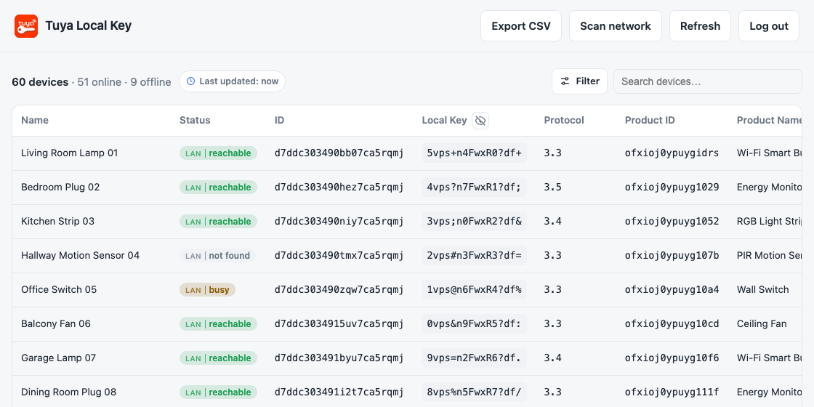

# Smartpilot-local-first-home

**Smart Pilot Unified v0.7:** See [SMART_PILOT_V07.md](SMART_PILOT_V07.md) for latest UX and LAN behavior.

> **v0.6 Tuya reliability hotfix:** See [SMART_PILOT_V06.md](SMART_PILOT_V06.md) for double-tap UI, command serialization, readback and mobile scrolling optimizations. This is **source**, not a hardware-tested APK.

> **Smart Pilot v0.5 (beta):** [What changed and how to build](SMART_PILOT_V05.md). Home remains compact and duplicate-free; stale AC values and unknown controls now fail safe. Haier direct LAN is still hardware-unverified; source ZIP is not an APK.

> **v0.4 Compact Home UI update:** [SMART_PILOT_COMPACT_V04.md](SMART_PILOT_COMPACT_V04.md). Fixes duplicated controls/scrolling while preserving Haier and Tuya backend.

> **NEW experimental unified Haier+Tuya UI:** See [SMART_PILOT_UNIFIED_V03.md](SMART_PILOT_UNIFIED_V03.md) for exact scope, limitations and setup.

[](https://github.com/Muhammadusamataj/MYlocal-devices-tuya/pkgs/container/mylocal-devices-tuya)

# MY Local Devices Tuya

<picture>
  <source media="(prefers-color-scheme: dark)" srcset="docs/screenshots/header-devices-dark.png">
  <source media="(prefers-color-scheme: light)" srcset="docs/screenshots/header-devices-light.png">
  
</picture>

A fork of **Tuya Local Key** with a devices-first local control screen. Log in once with your Smart Life user code; local keys, IP addresses and protocol versions are remembered so daily ON/OFF control works without the cloud.

> HACS is not required for the add-on (it is a small web server installed from the Supervisor add-on store). An optional **custom integration** is also included in `custom_components/mylocal_devices` if you want Home Assistant entities for automations and dashboards.

## Features

- Devices screen first: big ON/OFF switches, live readings, search, collapsed advanced DPs, and an optional card layout.
- Honest connection states: verified **Online**, saved address awaiting reply, and offline/stale readings are shown separately.
- LAN connections are saved in `lan-profile.json`; after setup the app reuses them and silently reconnects if the network changes.
- QR login fetches local keys; manual device add is also available from Settings.
- Local status/commands reuse encrypted caches and make no cloud request.
- Home Assistant ingress support, so Tailscale / WireGuard add-ons can provide secure remote access without router port forwarding.
- Optional Windows EXE and fully offline Android APK builds are included in the repo.
- Original key-finding features: device list, filters, CSV export, network scan, change detection, and support reports.

## Premium `/local` dashboard

Open <http://localhost:8000/local> (Docker), the add-on ingress URL, or the desktop/Android app to use the local-first dashboard. It has **Home**, **Haier AC**, **Devices**, **Scenes**, and **Advanced** views:

- **Home** — one compact summary tile per Haier AC and per Tuya device; no repeated full controls.
- **Haier AC** — detailed Direct-LAN controls and independent Manual/Auto mode.
- **Devices** — Tuya device controls, supported DPs, and live readings.
- **Scenes** — group commands and save/replay scenes from the server.
- **Advanced** — key/device setup, network scan, and diagnostics.

Status is honest: **Online** means a recent local reply was verified, **Address saved** means an IP is known but no reply has arrived, and **Offline**/stale readings are called out. Statuses update silently if the network changes.

> **Scenes and schedules run on the server/host** (Home Assistant add-on, Docker, or always-on PC). They require that host to be awake and the app server to be running. Timers inside the Android WebView with the phone closed are **not reliable** and must not be relied on. See the [hardware validation checklist](docs/HARDWARE_CHECKLIST.md) for what to verify on real devices.

## Home Assistant add-on (recommended)

1. Make sure this repository is **public**.
2. In Home Assistant go to **Settings → Add-ons → App store → ⋮ → Repositories** and add:

   ```text
   https://github.com/Muhammadusamataj/MYlocal-devices-tuya
   ```

3. Install **MY Local Devices Tuya**, start it, and open it from the sidebar. It opens directly on the **Devices** screen.
   The add-on builds from source inside Home Assistant (`tuya_local_key/Dockerfile`), so no GHCR image or GitHub Actions run is needed.
4. If keys are not loaded yet, open **Settings → Setup / Smart Life login** in the drawer.
5. For remote access, install the **Tailscale** (or WireGuard) add-on in Home Assistant and open this add-on from the HA sidebar. Ingress handles authentication; the VPN handles encryption. No router setup is needed.

[](https://my.home-assistant.io/redirect/supervisor_add_addon_repository/?repository_url=https%3A%2F%2Fgithub.com%2FMuhammadusamataj%2FMYlocal-devices-tuya)

After editing the web app, run `python tools/sync_addon.py` and commit the generated `tuya_local_key/app/` folder so the add-on build always contains the latest code. CI also verifies that the add-on and offline-APK source mirrors stay in sync.

See [CHANGELOG.md](CHANGELOG.md) for the latest changes and release signing notes.

## Home Assistant entities / automations (optional)

The add-on alone is a web UI. To use its devices in automations, copy
`custom_components/mylocal_devices` into your HA config folder, restart HA, then use
**Settings → Devices & Services → Add Integration → MY Local Devices Tuya**. It
creates `switch.*` and `sensor.*` entities from the saved devices, with no cloud
requests. See [custom integration guide](docs/custom-integration.md).

## Docker

Build from this repository (same source the HA add-on uses):

```bash
docker compose up -d --build
```

Open <http://localhost:8000/local>. For access beyond localhost set both `AUTH_USERNAME` and `AUTH_PASSWORD`; see [configuration](docs/configuration.md#security).

## Local builds

```bash
# Windows EXE -> dist/TuyaLocalKey.exe
python build_exe.py

# Offline Android APK -> dist/TuyaLocalKey-Offline.apk
python build_offline_apk.py --install
```

For a safe, reproducible update of a connected device (single authorized device,
or pass `--serial`), use:

```bash
python tools/adb_update.py
```

It detects the installed variant and version, builds the matching APK, installs
with `adb install -r` (never uninstall / clear data), launches the app and prints
filtered logcat errors. Stop and investigate if Android reports a signing
mismatch. See the [Android hardware checks](docs/HARDWARE_CHECKLIST.md#4-android-checks)
for the full on-device verification steps.

The APKs currently in `dist/` are debug-signed builds for local testing and
version updates. Release builds deliberately require your own signing credentials
(`RELEASE_STORE_FILE`, `RELEASE_STORE_PASSWORD`, `RELEASE_KEY_ALIAS`,
`RELEASE_KEY_PASSWORD`); they never fall back to the public Android debug key.

## Documentation

- [Installation](docs/installation.md)
- [Using the app](docs/usage.md)
- [Configuration and remote access](docs/configuration.md)
- [Network scanning](docs/network-scanning.md)
- [Hardware validation checklist](docs/HARDWARE_CHECKLIST.md)
- [Troubleshooting](docs/troubleshooting.md)

## Credits and license

Based on [Tuya Local Key](https://github.com/vineetchoudhary/tuya-local-key) by Vineet Choudhary. Licensed under the [Apache License, Version 2.0](LICENSE); see [NOTICE](NOTICE) for attribution.
